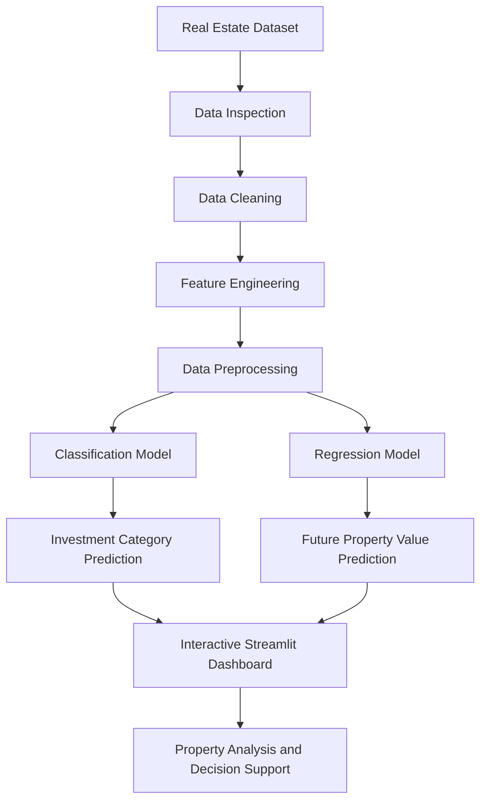

<div align="center">

# 🏡 Real Estate Investment Advisor

### Predicting Property Profitability & Future Value

**Transform real estate data into actionable investment insights using Python, Machine Learning, and Interactive Analytics.**

<br>

<a href="https://9gnxascc5rfggzpen43dfy.streamlit.app/">
  
</a>

<br><br>


</div>

---

## 📌 Project Overview

The **Real Estate Investment Advisor** is a machine-learning-powered application designed to support property investment research through predictive analytics, data exploration, and interactive visualizations.

The project combines real estate data analysis with predictive modeling to help users investigate property characteristics, evaluate potential profitability, and estimate future property values.

By bringing analytical insights and predictive models into an interactive application, the project demonstrates how data science can support business-oriented decision-making.

### 🎯 Business Problem

Real estate investment decisions involve multiple factors, including property prices, location, property characteristics, market conditions, and potential appreciation.

Analyzing these factors manually can be time-consuming and may make it difficult to compare investment opportunities consistently.

This project aims to address that challenge by providing a data-driven framework for property analysis and investment evaluation.

### 💡 Project Objectives

- Analyze real estate data to identify meaningful patterns and relationships.
- Explore property pricing and market characteristics.
- Apply machine learning to estimate property investment potential.
- Predict future property values using a regression approach.
- Present analytical findings through an interactive web application.
- Support property comparisons using measurable indicators and user-defined assumptions.

---

## 🚀 Live Application

### Explore the interactive dashboard

**[🏡 Launch Real Estate Investment Advisor](https://9gnxascc5rfggzpen43dfy.streamlit.app/)**

Open the live application to explore the available features, enter property information, and examine the predictions and visualizations provided by the deployed model.

> **Note:** The live application must be accessible for the demo link to work. Features described below should be retained in this README only when they are implemented in the deployed version.

---

## ✨ Key Features

### 1. 🏘️ Property Investment Prediction

Use the available property inputs to evaluate a property's estimated investment potential.

The classification workflow is intended to help distinguish between investment categories based on the model's learned patterns.

**Business value:** Provides a consistent, data-driven starting point for comparing property opportunities.

### 2. 📈 Future Property Value Prediction

Use the regression workflow to estimate a property's future value based on the supported property features.

The predicted value can help users explore possible appreciation outcomes over the model's forecast horizon.

**Business value:** Helps users investigate potential changes in property value rather than relying exclusively on the current purchase price.

### 3. 📊 Interactive Real Estate Analytics

Visual analytics can make property data easier to understand and compare.

Recommended analytical views include:

- Property price distribution.
- Price comparisons across locations.
- Property characteristics and price relationships.
- Predicted future value versus current price.
- Investment opportunity comparisons.
- Model evaluation and prediction analysis.

Interactive charts can support filtering, hovering, zooming, and detailed exploration when implemented in the application.

### 4. 🧠 Machine Learning

The project uses a machine-learning workflow to transform prepared property data into predictive outputs.

The workflow can include:

- Data preprocessing.
- Feature transformation.
- Classification.
- Regression.
- Model evaluation.
- Prediction visualization.

The exact algorithms and evaluation results should be documented using the models and metrics actually present in the project.

### 5. 💼 Business-Oriented Decision Support

The application connects predictive analytics with a practical business use case.

Rather than presenting model outputs in isolation, the project focuses on helping users interpret property information and investigate investment scenarios.

---

## 📊 Analytical Insights and Visualizations

The following table describes the visualizations recommended for a comprehensive real estate analytics dashboard.

| Visualization | Analytical purpose | Business question |
|---|---|---|
| Property Price Distribution | Understand the spread of property prices | What price ranges are most common? |
| Location-Based Price Comparison | Compare prices across available locations | Which locations have higher or lower property prices? |
| Property Feature Analysis | Examine relationships between property attributes and price | Which property characteristics are associated with price differences? |
| Predicted vs. Current Value | Compare the estimated future value with the current price | What appreciation does the model estimate? |
| Investment Category Analysis | Examine the distribution of predicted categories | How are properties classified by the model? |
| Actual vs. Predicted Values | Evaluate regression predictions against observed values | How closely do predictions match actual outcomes? |
| Feature Importance | Explore influential model inputs | Which features contribute most to model predictions? |
| Model Performance Dashboard | Present appropriate evaluation metrics | How well does the model perform on unseen data? |

*These are recommended analytical views, not a claim that every chart is already implemented in the live application.*

### 🔍 Suggested Advanced Analytics

Further improvements could include:

- Interactive property comparison.
- Price and location filters.
- Investment scenario simulation.
- Sensitivity analysis for appreciation assumptions.
- Explainability using suitable feature-importance methods.
- Downloadable prediction summaries.
- Model performance monitoring.

These additions can help evolve the application from a prediction interface into a more comprehensive real estate analytics platform.

---

## 🛠️ Technology Stack

| Technology | Purpose |
|---|---|
| Python | Core programming language |
| Pandas | Data manipulation and analysis |
| NumPy | Numerical operations |
| Scikit-learn | Machine learning and preprocessing |
| Streamlit | Interactive web application |
| Plotly, if used | Interactive data visualization |
| Matplotlib / Seaborn, if used | Exploratory data visualization |
| Jupyter Notebook, if used | Data exploration and experimentation |
| Git and GitHub | Version control and project collaboration |

The final dependency list should match the packages actually used by the application.

---

## ⚙️ Machine Learning Workflow

The project follows a structured machine-learning pipeline.



### Workflow Explanation

**1. Data Collection**

Load the available housing dataset and inspect its structure, feature types, and target variables.

**2. Data Cleaning**

Address missing values, duplicates, inconsistent data types, and other data-quality issues where applicable.

**3. Feature Engineering**

Prepare suitable features for modeling based on the available property data.

**4. Data Preprocessing**

Apply the necessary transformations to numerical and categorical features.

**5. Model Development**

Train or load the classification and regression models used by the project.

**6. Model Evaluation**

Evaluate the models using appropriate metrics and data that were not used to fit the models.

**7. Deployment**

Integrate the models into a Streamlit application that presents predictions and analytical insights.

---

## 📏 Model Evaluation

Model performance should be assessed using metrics appropriate to each task.

### Classification

Potential evaluation metrics include:

- Accuracy.
- Precision.
- Recall.
- F1-score.
- Confusion matrix.
- ROC-AUC, where appropriate.

### Regression

Potential evaluation metrics include:

- Mean Absolute Error (MAE).
- Root Mean Squared Error (RMSE).
- R² score.

Actual metric values should be added after evaluation on an appropriate test dataset.

A high training score alone does not establish that a model will generalize well to unseen properties.

---

## 💻 Run the Project Locally

Follow these instructions to run the project on your own computer.

### Prerequisites

- Python installed.
- Git installed.
- Access to the project repository.
- Required model artifacts and dataset files.
- Compatible versions of the project's dependencies.

### Step 1: Clone the Repository

Replace `YOUR_GITHUB_USERNAME` with the actual repository owner's username.

```bash
git clone https://github.com/YOUR_GITHUB_USERNAME/Real-Estate-Investment-Advisor-Predicting-Property-Profitability-Future-Value.git
```

### Step 2: Navigate to the Project

```bash
cd Real-Estate-Investment-Advisor-Predicting-Property-Profitability-Future-Value
```

### Step 3: Create a Virtual Environment

```bash
python -m venv .venv
```

Activate it on Windows CMD:

```cmd
.venv\Scripts\activate
```

### Step 4: Install Dependencies

If the repository includes a `requirements.txt` file:

```bash
python -m pip install -r requirements.txt
```

### Step 5: Run the Application

If the Streamlit entry point is `app.py`:

```bash
streamlit run app.py
```

Streamlit will provide a local address where you can open the application in your browser.

### ⚠️ Model Compatibility

Serialized machine-learning models can depend on the versions of the libraries used to create them.

In particular, ensure that the installed scikit-learn version is compatible with the saved models and preprocessing objects.

Use the tested dependency versions documented in the repository rather than arbitrarily upgrading or downgrading packages.

---

## 📂 Project Structure

The following is an illustrative structure. Update it to match the actual repository.

```text
Real-Estate-Investment-Advisor/
│
├── app.py
├── requirements.txt
├── README.md
├── .gitignore
│
├── data/
│   └── cleaned_housing.csv
│
├── models/
│   ├── classification_model
│   ├── regression_model
│   └── preprocessing_artifacts
│
├── notebooks/
│   └── exploratory_data_analysis.ipynb
│
└── assets/
    └── dashboard_screenshots/
```

Model filenames and notebook names are examples; use the actual filenames in the repository.

### Dataset Considerations

The project includes a prepared housing dataset for analysis.

Before redistributing a dataset, confirm that its license and usage terms permit publication.

Large datasets can increase repository size and make cloning slower. If the full dataset is not essential for reproducing the application, consider providing a smaller sample and documenting how to obtain the original data.

---

## 🎯 Business Applications

The analytical approach demonstrated in this project can support several real estate research activities.

**Property Evaluation**

Compare property characteristics and model-estimated investment outcomes.

**Market Exploration**

Investigate price patterns and differences across available locations and property categories.

**Investment Scenario Analysis**

Explore how changes in assumptions affect hypothetical future values and potential returns.

**Decision Support**

Use consistent analytical indicators to compare opportunities before conducting further due diligence.

**Predictive Analytics**

Demonstrate how machine learning can be integrated into a user-facing business application.

The application is a decision-support tool, not a replacement for property inspections, legal checks, independent valuations, or financial due diligence.

---

## 🔮 Future Enhancements

Potential future improvements include:

- [ ] Executive KPI dashboard.
- [ ] Interactive property comparison.
- [ ] Investment ROI calculator.
- [ ] Configurable future-value scenarios.
- [ ] Location-based market analysis.
- [ ] Explainable AI visualizations.
- [ ] Model evaluation dashboard.
- [ ] Downloadable prediction reports.
- [ ] Automated data-quality checks.
- [ ] Automated testing and deployment workflow.

These items represent possible improvements and should be marked complete only after implementation and testing.

---

## ⚠️ Disclaimer

This application is intended for educational, analytical, and research purposes.

Machine-learning predictions are estimates derived from available data and model assumptions. They do not guarantee future property values, appreciation, rental income, profitability, or investment returns.

Actual real estate outcomes depend on market conditions, location, property condition, financing, taxes, maintenance, regulations, and other factors that may not be represented in the dataset.

Users should independently verify information and seek appropriate professional advice before making investment decisions.

---

## 👨‍💻 Author

**Suman Sangeet**

Aspiring Data Analytics and Machine Learning Professional

Interested in data-driven business decisions, predictive analytics, and interactive visualization.

- **GitHub:** [Explore my projects](https://github.com/SUMANSANGEET)
- **Live Project:** [Real Estate Investment Advisor](https://9gnxascc5rfggzpen43dfy.streamlit.app/)

---

## ⭐ Support

If you find this project useful, consider starring the repository and exploring the live application.

Feedback and suggestions for improving the analytical workflow, visualizations, and application usability are welcome.

---

<div align="center">

**Turning Property Data into Investment Insights.**

*Built with Python, Machine Learning, and Streamlit.*

</div>
